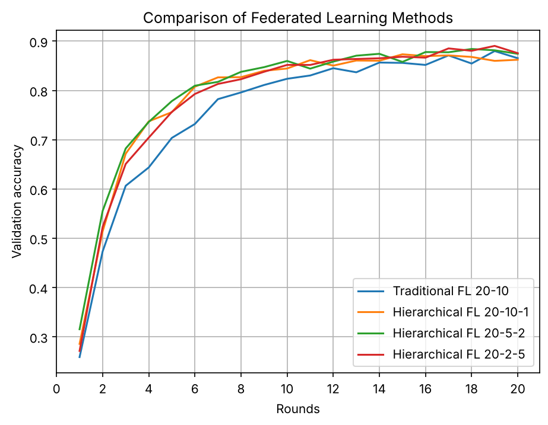

# Federated Learning for Brain Tumor Classification

Comparing **Traditional** and **Hierarchical Federated Learning** against a centralized (non-FL) baseline for 44-class brain tumor classification on MRI scans.

Final project of the **MaSSP Data Science 2024** summer program (Team 1).

> **TL;DR** — Federated models reach almost the same accuracy as centralized training (88.91% vs 89.35%), and Hierarchical FL hits 80% validation accuracy in ~6 rounds versus ~9 for Traditional FL.

<p align="center">
  
</p>

## Motivation

Deep learning can speed up brain tumor diagnosis from MRI, but good models need diverse data, and medical data is hard to pool because of privacy rules. Federated Learning trains one shared model across institutions by exchanging **model weights instead of patient images**. Hierarchical FL adds a layer of edge ("sub-global") servers that aggregate nearby clients first, cutting the number of trips to the global server.

We wanted to know:
1. Can FL get close to a model trained on all the data in one place?
2. Does Hierarchical FL converge faster than Traditional FL, and which hierarchy setting works best?

## Method

| | |
|---|---|
| **FL model** | ResNet-50 pretrained on ImageNet, head replaced with `Linear(2048→512) → ReLU → Linear(512→44)`, no frozen layers |
| **Baseline model** | EfficientNet-B3 pretrained on ImageNet, head `BN → Linear(→256) → BN → ReLU → Linear(256→44)` <!-- TODO: confirm this is the model behind the 89.35% --> |
| **Loss** | Cross-entropy weighted by inverse class frequency |
| **Aggregation** | FedAvg, weighted by client dataset size |
| **Clients** | 20, training split divided randomly into equal parts (IID); 5 edge servers × 4 clients in the hierarchical setup |
| **Split** | 80/20 train/validation from `Training/`, test on `Testing/` |
| **Optimizer** | Adam, lr = 3e-4, no decay |
| **Preprocessing** | Resize to 224×224, random flips + rotation, normalize with dataset mean/std |
| **Budget** | 20 global rounds, 10 local weight updates per round |

```
Traditional FL                     Hierarchical FL
                                          Global server
   Global server                   ┌──────────┼──────────┐
 ┌──────┼──────┐               Sub-global  Sub-global  Sub-global
Client Client Client            ┌──┴──┐     ┌──┴──┐     ┌──┴──┐
                              Client Client Client Client Client Client
```

Each global round, every client trains `sub_rounds × epochs_per_client = 10` epochs in total. The setups differ in how often the edge servers average their clients in between:

| Setup | Sub-rounds | Epochs per client |
|---|---|---|
| Traditional FL 20-10 | 1 | 10 |
| Hierarchical FL 20-10-1 | 10 | 1 |
| Hierarchical FL 20-5-2 | 5 | 2 |
| Hierarchical FL 20-2-5 | 2 | 5 |

## Results

Test accuracy on the held-out test set:

| Method | Test accuracy |
|---|---|
| Non-federated (centralized) | **89.35%** |
| Traditional FL | 88.03% |
| Hierarchical FL 2-5 | 88.40% |
| Hierarchical FL 5-2 | **88.91%** |
| Hierarchical FL 10-1 | 87.89% |

- FL is within ~0.5 percentage points of centralized training.
- All hierarchical setups pass 80% validation accuracy by round 6; Traditional FL needs ~9 rounds.
- **5 sub-rounds × 2 epochs** is the sweet spot: enough local training to move fast, not so much that clients drift toward different local minima.

Full write-up: [`docs/report.pdf`](docs/report.pdf) · Slides: [`docs/slides.pdf`](docs/slides.pdf)

## Dataset

[Brain Tumor MRI Images – 44 Classes](https://www.kaggle.com/search?q=Brain+Tumor+MRI+Images+44+Classes) by Fernando Feltrin (public, Kaggle) — 4,479 T1, T1C+ and T2 images covering normal scans and 14 tumor types (astrocytoma, glioblastoma, meningioma, schwannoma, …), each in 3 sequences. We did not collect this data; images are not included in this repo.

Put the data at `data/44_classes/` with `Training/` and `Testing/` subfolders. See [`data/README.md`](data/README.md).

## Repository structure

```
├── notebooks/
│   ├── 01_centralized_baseline.ipynb   # non-FL baseline (EfficientNet-B3)
│   ├── 02_federated_learning.ipynb     # train_hierarchical(); sub_rounds=1 gives Traditional FL
│   └── 03_results.ipynb                # plots and comparison
├── results/
│   ├── training_logs.xlsx              # per-round loss/accuracy for every run
│   ├── validation_accuracy.csv
│   └── figures/
├── docs/
│   ├── report.pdf
│   └── slides.pdf
├── data/README.md                      # how to get the dataset
├── requirements.txt
└── README.md
```

## Running it

The notebooks were written for Google Colab with a GPU.

```bash
git clone https://github.com/Tramdanglamduoc/Federated-Learning-in-Brain-Tumor-Classification.git
cd Federated-Learning-in-Brain-Tumor-Classification
pip install -r requirements.txt
```

Then open the notebooks in order. In `02_federated_learning.ipynb`, change the last line of the training cell to pick a setup:

```python
model, hist = train_hierarchical(dataset, rounds=20, sub_rounds=5, epoch_per_client=2, seed=42, device=device)
# Traditional FL: sub_rounds=1, epoch_per_client=10
```
 Each FL run trains 20 ResNet-50 clients, so expect several hours per configuration on a single Colab GPU.

## Limitations and future work

- Data is split **IID** across equally sized clients, which is the easy case. Real hospitals have non-IID, imbalanced data.
- Only FedAvg was tested; FedProx, FedNova, etc. may behave differently.
- No learning-rate decay.
- FL training took much longer than centralized training in simulation (clients ran sequentially on one GPU).

## Team

- **Bui Huy Giap** — VNU-HCM University of Science
- **Tran Ngoc Bao Tram** — Riga Technical University
- **Hoang Thi Anh Thu** — Amherst College
- **Diep Tuong Nghiem** — Mentor

MaSSP Math and Computer Science 2024.

## Citation

```bibtex
@misc{massp2024flbraintumor,
  title  = {Performance Evaluation of Federated Learning Techniques in Brain Tumor Classification},
  author = {Bui, Huy Giap and Tran, Ngoc Bao Tram and Hoang, Thi Anh Thu and Diep, Tuong Nghiem},
  year   = {2024},
  note   = {MaSSP Data Science 2024 final project}
}
```

## References

- McMahan et al., *Communication-Efficient Learning of Deep Networks from Decentralized Data*, 2016. [arXiv:1602.05629](https://arxiv.org/abs/1602.05629)
- Liu et al., *Client-Edge-Cloud Hierarchical Federated Learning*, ICC 2020. [doi:10.1109/ICC40277.2020.9148862](https://doi.org/10.1109/ICC40277.2020.9148862)
- He et al., *Deep Residual Learning for Image Recognition*, 2015. [arXiv:1512.03385](https://arxiv.org/abs/1512.03385)

Full reference list in the report.
